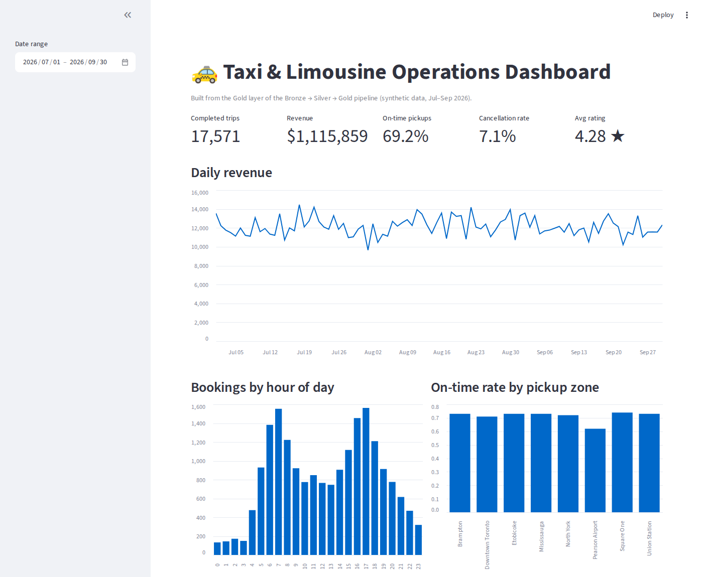

# 🚕 Taxi Trip Data Pipeline

An end-to-end **ETL pipeline** that turns a messy raw export of taxi & limousine trips into clean, validated data and **business KPI tables**, with a dashboard on top.

It follows the **Bronze → Silver → Gold** (medallion) pattern used on platforms like Azure Databricks, built here with Python, pandas and SQLite so it runs on any laptop. The idea comes from my work at a taxi & limousine company, where dispatch data is messy and decisions depend on it.



---

## 🏗️ Architecture
```
 raw_trips.csv          BRONZE                 SILVER                       GOLD
 (messy export)  ──►  bronze_trips  ──►  silver_trips (clean)   ──►  gold_daily_kpis
                      as received,        + silver_rejected            gold_hourly_demand
                      nothing fixed         (with reason)              gold_zone_performance
                                                                       gold_top_routes
                                                                       gold_vehicle_summary
                                                                       gold_driver_performance
                                                                               │
                                                               dashboard.py / Power BI / Excel
```
| Layer | What happens | Why |
|---|---|---|
| **Bronze** | Raw file loaded as-is (all text) + ingestion time and source file | Keeps an untouched copy for audits and re-runs |
| **Silver** | Remove duplicates, fix types, standardise names, validate rules | Trustworthy data; nothing disappears silently |
| **Gold** | Aggregated KPI tables | Ready for dashboards and decisions |

## 🧹 Data quality: what the pipeline catches
The raw export has the problems real data has. Results from the last run:

| Check | Rows |
|---|---|
| Raw rows | 20,360 |
| Duplicates removed | 360 |
| Rejected: missing pickup zone | 191 |
| Rejected: non-positive fare | 108 |
| Rejected: drop-off before pick-up | 81 |
| Rejected: impossible distance | 59 |
| **Clean rows** | **19,561 (97.8% of unique trips)** |

It also **fixes** without rejecting:
- **Mixed date formats** (`2026-07-01 08:30:00` and `01/07/2026 08:30`)
- **Fares stored as text** (`$45.00`)
- **Inconsistent zone names** (`yyz`, `Pearson Intl Airport` and `  pearson airport ` all become `Pearson Airport`)

Every rejected row is kept in `silver_rejected` **with the reason**, so it can be reviewed and fixed at the source. Full report: [`reports/data_quality.md`](reports/data_quality.md)

## 📊 Example insights (synthetic data, Jul–Sep 2026)
- **17,571 completed trips** and **$1.12M revenue** (fares + tips)
- **Pearson Airport has the lowest on-time pickup rate (62% vs. ~72% elsewhere)** but the most revenue, so it's the first place to improve dispatch
- Demand peaks at **7 am and 5 pm**, which tells you when to schedule more drivers
- **7.1% cancellation rate**, tracked daily

## ▶️ How to Run
```bash
git clone https://github.com/samhadd-ad/taxi-trip-data-pipeline.git
cd taxi-trip-data-pipeline
pip install -r requirements.txt

python data/generate_raw.py   # creates the messy raw export
python run_pipeline.py        # Bronze → Silver → Gold
streamlit run dashboard.py    # opens the dashboard
pytest                        # runs the tests
```
Gold tables are also saved as CSV in `warehouse/gold/`, ready to open in **Power BI** or Excel.

## 📁 Project Structure
```
├── run_pipeline.py          # runs all three layers + writes the report
├── dashboard.py             # Streamlit KPI dashboard
├── data/generate_raw.py     # synthetic messy raw data
├── pipeline/
│   ├── bronze.py            # land raw data
│   ├── silver.py            # clean, standardise, validate
│   └── gold.py              # KPI tables
├── warehouse/gold/          # gold tables as CSV
├── reports/                 # data quality report, screenshot
└── tests/                   # pytest: cleaning rules and KPI math
```

## ✅ Tests
`tests/test_pipeline.py` checks date parsing, zone cleaning, money parsing, that each kind of bad row is rejected with the right reason, that cancelled trips are kept, and that the KPI math (cancellation rate, on-time rate, revenue) is correct.

## 🔮 Next Steps
- Move to Azure: Data Factory (ingest) → Data Lake (Bronze/Silver/Gold files) → Databricks (transform) → Power BI (dashboard)
- Run incrementally (only new trips each day) and schedule it
- Alert when a data-quality check fails above a threshold

## 🧰 Tech
Python · pandas · SQLite · SQL · Streamlit · pytest
